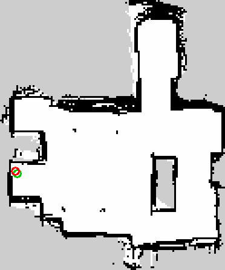
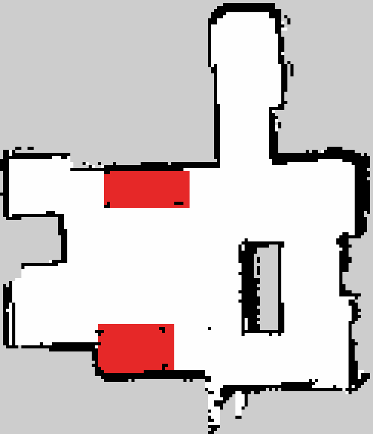

**中文** | [English](README_en.md)

# JetRover 移动抓取系统

在 Hiwonder **JetRover**(Jetson Orin NX 16GB,原生 Ubuntu 22.04 + ROS2 Humble)真机上开发的
**语言/视觉驱动移动抓取系统**。差异化靠**工程深度**:量化评估、失败处理、多方案权衡
(见 [docs/engineering_decisions.md](docs/engineering_decisions.md) D1–D6,每条含真机证据),
而非堆功能。

## Demo videos(演示视频)

Short clips from the real robot, plus one simulation clip. GitHub does not play video inline from a README, so each row links to the file under `media/` (click ▶; GitHub's file page has a player).
真机实拍短片 + 一段仿真;GitHub 不在 README 里内嵌播放,点 ▶ 到文件页播放。

| Clip | What it shows | Length |
|---|---|---|
| **01 Mapping**<br>[▶ watch](media/01_mapping_en.mp4) | SLAM Toolbox 2D-lidar mapping of the apartment (gamepad teleop, loop closed at the start point, map exported with a custom script).<br>SLAM Toolbox 雷达建图:手柄遥控绕场,回到起点闭合回环,自写脚本存图。 | 34 s |
| **02 Keep-out zones**<br>[▶ watch](media/02_keepout_zones_en.mp4) | Hand-drawn keep-out zones (red) turned into a Nav2 costmap filter mask; the global planner routes around them.<br>手画禁行区 → Nav2 代价地图过滤层,全局规划绕开。 | 15 s |
| **03 Full mission**<br>[▶ watch](media/03_full_mission_en.mp4) | Full mission run, 2026-10-22: start → Nav2 to the pickup station → pre-grasp visual closed loop → grasp → carry to the delivery station → placement¹. Phone footage synced with the Foxglove map view as picture-in-picture; played at 2×.<br>10-22 完整任务:起点→导航到取货区→抓前视觉闭环→抓取→携带到放置区→放置¹;手机实拍 + Foxglove 地图小窗同步,2 倍速。 | 62 s (2×) |
| **Sim: MoveIt 2 grasp**<br>[▶ watch](media/sim_moveit_grasp_en.mp4) | ROS 2 + MoveIt 2 pick-and-place in Gazebo. Simulation only — not the real robot.<br>ROS 2 + MoveIt 2 Gazebo 仿真抓取,纯仿真、非真机。 | 73 s |

¹ The placement segment of clip 03 is a separate take: the robot was positioned at the mat by hand and the arm ran a scripted put-down (`scripts/put_down.py`, no vision). The autonomous placement skill (`scripts/task_place.py`) is still being validated on the robot; in this run the autonomous part ends after the carry to the delivery station.<br>
¹ 03 号片的放置段是单独补拍:车由人摆到垫边,臂只执行预设放下动作(`scripts/put_down.py`,无视觉);自主放置技能 `scripts/task_place.py` 仍在真机验证中,本次自主运行到携带至放置区为止。

Stills(静帧):

<p>
  <a href="media/stills/01_map_apartment_loop_20260903.png"></a>
  <a href="media/stills/04_keepout_zones_red.png"></a>
</p>

Left: apartment loop map (SLAM Toolbox, 2026-09-03) · right: keep-out zones (red) over the same map.
左:公寓回环地图(09-03);右:同一张图上的禁行区(红)。

## 核心策略
**不修改厂家 vendor 代码**;在自有 workspace 里建包,只**调用** vendor 驱动
(底盘/雷达/相机/控制板/IK 服务),从不编辑它们。

## 能力一览(全部真机验证)
- **物体无关抓取**:深度地面分割检测任意落地物体(不依赖类别/颜色),自动判高、
  偏航对齐(±45° 斜置可抓)、夹爪宽度校验、多角度 IK 可达判定、失败拉黑防死循环
- **移动抓取**:超出臂展 → 自动前进/麦轮横移取货 → 里程计闭环原路返回 → 放置;
  贴轮超近目标先倒车让位;抬头扫视发现 **0.84m** 外目标并取回放置
- **语义层**:COCO(yolo11m)+ **开放词表(YOLO-World)** 融合——分割管几何、YOLO 管命名,
  运行时文字定类("toy block" 一次点名 6 个方块),为 LLM 层供词汇
- **鲁棒性**:雷达净空防护(移动前查净空/行进中急停);控制板锁死的**相机自证**检测
  (锁死时 odom/舵机回读都会说谎,唯一诚实证人=相机画面变化)
- **量化**:每次抓取入 CSV,`jr_report.py` 出报告(按角度/宽度/颜色/场次分解)
- **抓前视觉闭环**(2026-09-04 真机 6/6):检测后先到目标上方的预抓位,用眼在手相机测方块相对爪心的偏差并修正,
  再下探抓取;任务模式默认开启(`JR_CL=1`,`jr_grasp_all.py grasp_closed_loop`)
- **标定**:AprilTag 手眼标定(2026-09-03)证实相机支架托运弯了 16.7°,软件补偿(`JR_CAM_PITCH`);偏航角改为
  RGB 边缘法(±1.6°);臂运动学离线标定结论"零位不可辨识,剩余 8 mm 是柔性/死区"(`kin_calib_fit.py`)
- **部署链路**(2026-10):一条命令起全栈并自检(`mission_boot.sh` + `stack_wait.py`:话题/导航 action/AMCL/
  运行时参数覆写/初始位姿/蜂鸣,约 30 s);手工在地图上画禁行区 → Nav2 代价地图过滤层(`zone_paint.py`);
  Windows 侧用 Foxglove 远程可视化(`deploy/foxglove_up.sh`)

## 关键结果
- 抓取成功率:**85%**(22/26,2026-07-14 基准;基线 68% @ 06-30,+17pp 主要来自
  偏航对齐兑现——斜放 25-45° 达 90%);43mm 大方块 ±2.5mm 容错仍为系统精度标尺
- **完整任务链真机跑通**(2026-07-16):中文指令→导航到拿取区→抓取→携带跨房 1.5m→
  交付点扫视建图(AprilTag 锚点)→自主微调接近→米制格放置上垫,双方块双趟
- **真实物体**:笔(9mm 扁平)与U盘经开放词表点名后抓取放置成功(细长物垂直长轴抓取管线)
- 单日 **60+ 抓取循环零锁死**(运行纪律:单一长命节点跑批、动作期间零 CLI 探测、
  指令流 10Hz 限流——对比违反纪律时 1–2 抓一锁)
- 手眼/坐标核对残差 **2mm**(卷尺真值 vs 计算值,3 点拟合)
- **抓前视觉闭环真机验证**(2026-09-04):6 次全部收敛并抓起,3 次人工判定正中,开环在远处失败的点闭环成功;
  常数径向偏置 15 mm 已并入
- **10-22 任务链**(mission8,见 Demo 03):起点 → Nav2 到取货区 → 闭环抓取(修正 20 mm,夹爪像素校验在手)→
  携带导航到放置区,三段均成功;自主放置未完成——放置技能已重写为 `task_place.py`,待真机验证

## 里程碑
| | 内容 | 状态 |
|---|---|---|
| M1 | bringup + 遥控 + RViz | ✅ |
| M2 | 2D 雷达 SLAM 建图 | ✅ `map_02` → 公寓回环图 `apt_loop_20260903`(导航默认)、`apt_demo2_20261021`(10-21 演示) |
| M3 | Nav2 自主导航 | ✅ 控制器 TEB(RotationShim 包裹);打转四根因已取证、运行时补丁修复(D6、`stack_wait.py`),TEB vs MPPI 未定案;禁行区过滤层上线(10-21) |
| M4 | 检测 + 深度 → 3D(演进为物体无关分割) | ✅ |
| M4.5 | 手眼/坐标标定核对 | ✅ 2mm |
| M5 | 抓取状态机 + 量化 | ✅ 68% @ 31 |
| M6 | 移动抓取 + 导航任务(jr_mission carry) | ✅ 双方块双趟"导航→抓→携带→跨房→放上垫"真机跑通(07-16);丝滑度优化进行中 |
| M7 | 量化评估(Gazebo 经评估搁置,D2) | ✅ 22/26 = **85%**(07-14,较基线 +17pp;docs/benchmark_2026-07-14.md)|
| M8 | 工程化(自启/继电器/文档) | 🟡 一键净启动+自检 `mission_boot.sh`/`stack_wait.py` 已真机使用(10-21);systemd 自启待装机;继电器待购件(D1) |
| M9 | 语言→任务 | ✅ v1 真机指挥多轮(中文→解析→执行);Claude API 后端就绪待配 key |
| M10 | 放置技能重写(`task_place.py`:暗垫为主、标签可选、够不着自己挪车、失败保块、退出码=结果) | 🟡 10-22 代码完成并评审,**待真机验证** |

## 主要脚本(scripts/)
| 脚本 | 用途 |
|---|---|
| `jr_grasp_all.py` | 抓光全部状态机(`run`/`survey`/`grasp1`/`drivetest`;`JR_CL`(默认 1,抓前闭环)/`JR_YOLO`/`JR_TARGET`/`JR_CARRY`/`JR_MAX_WIDTH` 环控;旧 `place` 模式已退役,见 `task_place.py`) |
| `jr_detect_objects.py` | 物体无关实例检测 + YOLO/开放词表语义融合 |
| `jr_mission.py` | 导航→抓取→送达编排(`record` 录航点 / `run` 执行 mission.json;放置调 `task_place.py`,非零退出则保块停任务) |
| `mission_boot.sh` / `stack_wait.py` / `mission_launch.sh` / `stop_mission.sh` | 一键起栈并自检(READY 约 30 s)/ 起任务 / 按 PID 停任务 |
| `task_place.py` / `place_skill.py` | 放置技能(暗垫为主,标签可选;`--preflight/--look-only/--dry-run/--handin`;退出码=结果;10-22 待真机验证) |
| `zone_paint.py` / `nav_params_filters.py` / `make_filter_mask.py` | 在画图里手工标禁行区 → Nav2 代价地图过滤 mask / 带过滤层的 Nav2 参数 |
| `nav_goto.py` / `cost_at.py` / `setp.py` / `initpose.py` | rclpy 发导航目标(不走会卡的 ros2 CLI)/ 代价地图与 AMCL 位姿探针 / 运行时参数 / 初始位姿 |
| `handeye_calib.py` / `yaw_calib.py` / `kin_calib_fit.py` | AprilTag 手眼标定 / 偏航角标定 / 臂运动学离线标定 |
| `station_dock.py` | AprilTag 站点板精对位(实验;任务流已不再用) |
| `jr_report.py` | 抓取统计 CSV → 评估报告 |
| `jr_talk.py` | 中文指令 → 任务(M9;规则解析保底,设 `ANTHROPIC_API_KEY` 自动升级 LLM 解析) |
| `calib_measure.py` / `calib_fit.py` | 手眼标定核对(真机采集 / 笔记本拟合) |
| `mjpeg_stream.py` | 浏览器实时画面(检测叠加,:8080) |
| `scan_probe.py` | 雷达安装朝向标定 |

## 仓库结构
```
src/      自有 ROS2 包(jr_bringup / jr_teleop / jr_slam / jr_nav / jr_vision / jr_interfaces /
          jr_teleop_cpp = cmd_vel_relay 的 rclcpp 移植,学习用,未接入 launch)
scripts/  抓取/任务/放置/标定/评估/诊断脚本(平铺部署到机器人 ~/jetrover_ws/)
deploy/   systemd 自启(jr-stack.service + jr_stack.sh)、grasp_up / slam_up / map_session、foxglove_up(远程可视化)
firmware/ STM32 控制板 IWDG 看门狗(145 行 C,D1 取证,未装机)
docs/     设计文档、工程决策记录、交接与复盘(architecture_review_2026-10-22.md)
maps/     SLAM 地图(apt_loop_20260903 导航默认;apt_demo2/3_20261021;zones_keepout 禁行区 mask)
media/    演示视频(英文字幕)与静帧
test_data/ 离线检测用的深度/彩色样本
rviz/     RViz 配置(远程看车现在主要用 Foxglove)
```

## 运行(机器人上,先 `source ~/jetrover_ws/jr_env.sh`)
```
# 三件套(抓取):
ros2 launch jr_bringup robot.launch.py enable_camera:=true
ros2 launch kinematics kinematics_node.launch.py
python3 jr_grasp_all.py run          # 抓光地面,默认抓前闭环(JR_CL=1);语义:JR_YOLO=1 JR_TARGET=banana
# 任务(导航→抓→送):一条命令起全栈并自检,再起任务
bash mission_boot.sh 1.0 0.0 0       # 初始位姿 x y yaw(deg);READY 约 30 s,蜂鸣确认
bash mission_launch.sh               # 10 s 后开始 jr_mission.py run;bash stop_mission.sh 按 PID 停
# 放置技能单测(方块已在夹爪):
python3 task_place.py --preflight    # 再 --look-only / --dry-run / 真放;退出码见文件头
# 建图 / 遥控 / 可视化:deploy/map_session.sh、deploy/foxglove_up.sh;车上常用命令见 CLAUDE.md
```

## 关键教训(浓缩;详见 docs/engineering_decisions.md 与设计文档)
- **控制板锁死**:密集/畸形串口指令可致 MCU 锁死("命令死/遥测活"),软件无法自恢复,
  唯一解药=断电。对策=运行纪律(见上)+ 相机自证检测 + 继电器自动断电(M8);
  IWDG 固件看门狗经取证翻案但按 D1 降级为可选优化。
- **锁死时全部遥测不可信**:servo_states 回显目标值、odom 积分指令速度(板子纹丝不动
  却报"走了 0.073m",决定性实验)——执行确认只信物理证人。
- **2.4G WiFi 看原生相机**:rqt 传输选 **compressed**(raw 30Hz 大帧被 DDS 分片丢成 1fps);
  viewer 用 `rqt_image_view`(本机 `image_view` 的 compressed 订阅绑不上)。
- **远程看车用 Foxglove**(`deploy/foxglove_up.sh`,ws://车:8765),**别订阅相机原图**:桥吃 170% CPU,
  导航控制循环会被拖到 2 Hz(10-21)。
- **Jetson 开机后 NTP 会把系统时钟一次跳 80+ min**:等待/超时只能用 `time.monotonic()`,起栈前先等时钟同步(10-21)。
- **跨机时钟差** ~16ms:RViz 发初始位姿可能被 AMCL 拒;导航目标从机器人侧发(jr_mission 即如此)。
- **2D 雷达只有前方 ~180°**(后半被 vendor 裁掉);建图多转身刷视野。
- **活动控制器就是 TEB(RotationShim 包裹)**,早期"用 DWB"的记录是错的(D6):打转根因是 TEB 按差速车配置
  跑麦轮 + 限速在控制闭环外按轴钳制;修法是参数下沉与运行时补丁(`stack_wait.py`)。局部代价地图不要叠
  禁行区——足迹会被困在 inscribed 环里,每条轨迹都"不可行"(10-21)。
- SLAM:公寓尺度要开回环(`do_loop_closing: true`,09-03 回环图);小房间可关。慢速转身分段,
  床类"底空腿细"家具远距匀速过。
- **eye-in-hand**:舵机不上电臂自重下垂 → 相机外参未知;任何感知前先命令臂到已知位姿 hold。
  相机支架托运弯了 16.7°,已用 `JR_CAM_PITCH` 补偿并经 AprilTag 手眼标定证实(09-03)。
- **夹爪里的方块会挡住眼在手相机画面的下半中间**:放置时看垫子/标定板要停在 ≥ 0.9 m 外(10-22 三次摆拍
  失败的原因);探针要带着方块做,空夹爪的探针会误导。
